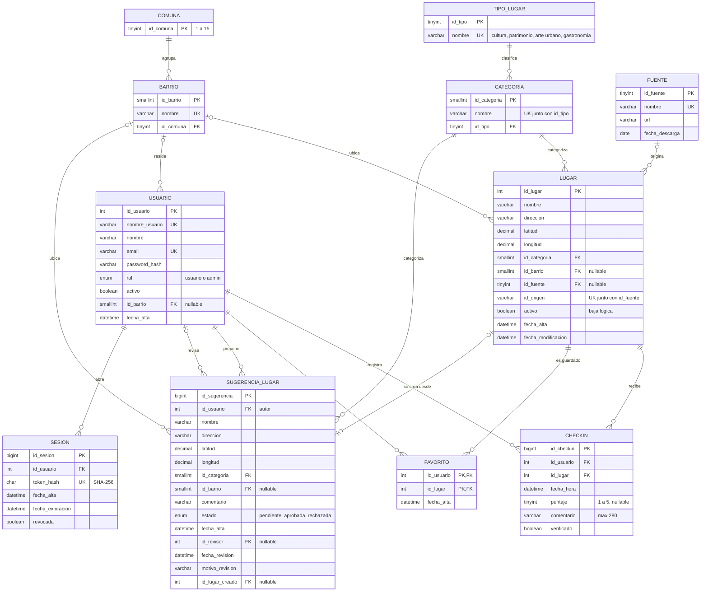

# Diagrama Entidad-Relación — Pasaporte BA

Corresponde exactamente al modelo implementado en `database/mysql/modelo_relacional.sql`.
GitHub y VS Code (con la extensión de Mermaid) lo renderizan directamente. Para el informe,
exportarlo como imagen desde <https://mermaid.live> (pegar el bloque y descargar PNG/SVG) y
guardarlo como `documentacion/DER.png`.

> Notación: pata de gallo (crow's foot). `||` = exactamente uno, `|o` = cero o uno,
> `o{` = cero o muchos. PK = clave primaria, FK = clave foránea, UK = única.

## Cardinalidades explicadas

| Relación | Cardinalidad | Lectura |
|---|---|---|
| Comuna – Barrio | 1 : N | Cada barrio pertenece a una sola comuna; una comuna agrupa varios barrios. |
| Tipo – Categoría | 1 : N | Cada categoría de origen (p. ej. "BAR", "BUSTO") cae en uno de los 4 tipos de la app. |
| Categoría – Lugar | 1 : N | Todo lugar tiene exactamente una categoría. |
| Barrio – Lugar | 0..1 : N | 270 lugares del dataset no tienen barrio validado (`id_barrio` NULL). |
| Fuente – Lugar | 0..1 : N | Los lugares cargados desde la app (por un admin) no tienen fuente. |
| Usuario – Lugar (Check-in) | N : M | Resuelta con la entidad **Check-in**, que tiene atributos propios (fecha, puntaje, comentario). Un usuario puede visitar el mismo lugar varias veces. |
| Usuario – Lugar (Favorito) | N : M | Resuelta con la tabla **Favorito**, PK compuesta: un lugar se guarda una sola vez por usuario. |
| Usuario – Sugerencia | 1 : N (autor) y 0..1 : N (revisor) | Dos relaciones distintas con la misma entidad. |
| Sugerencia – Lugar | 0..1 : 0..1 | Una sugerencia aprobada genera como máximo un lugar. |
| Usuario – Sesión | 1 : N | Sesiones revocables; se guarda solo el hash del token. |
